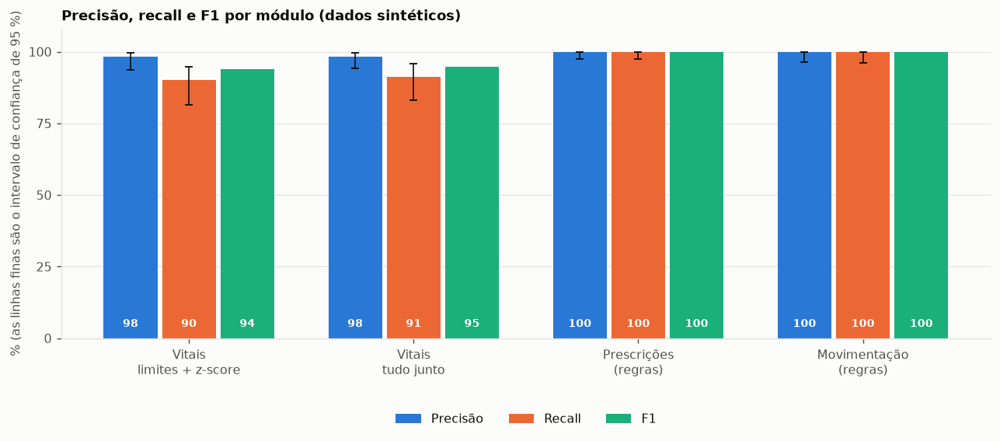
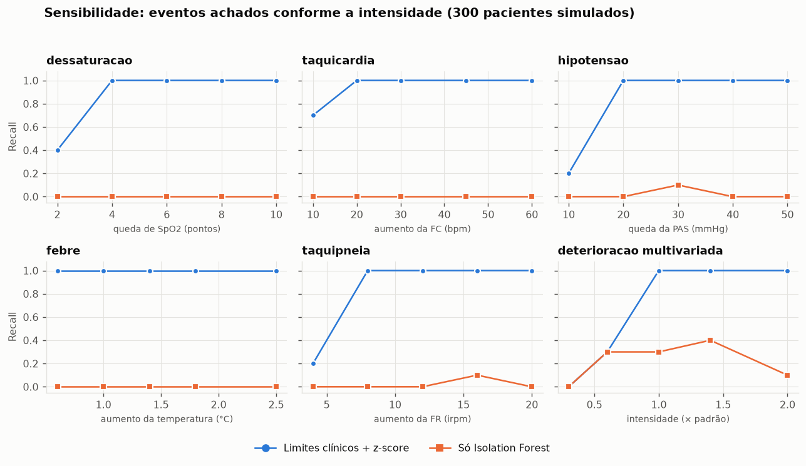
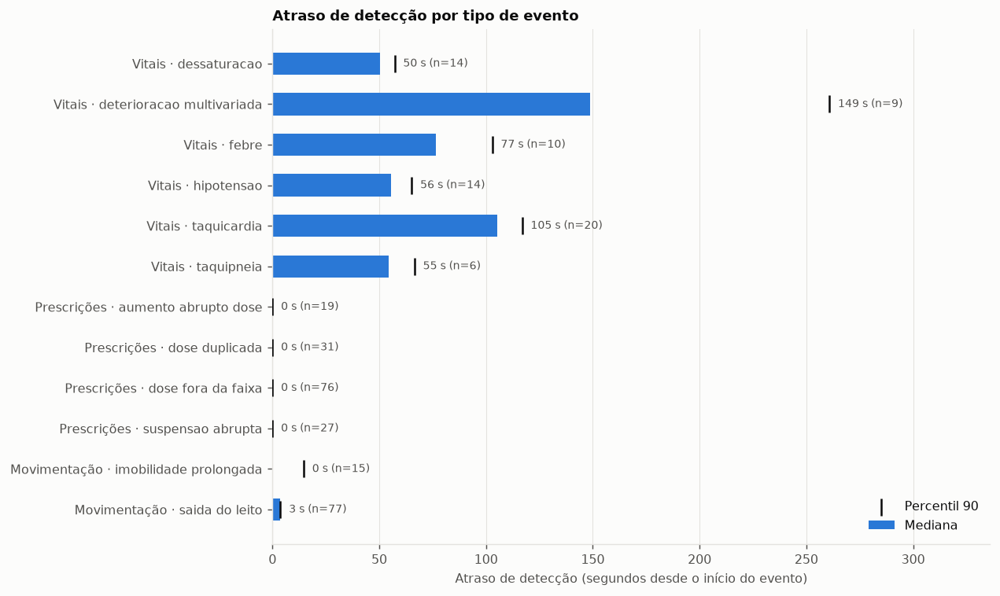
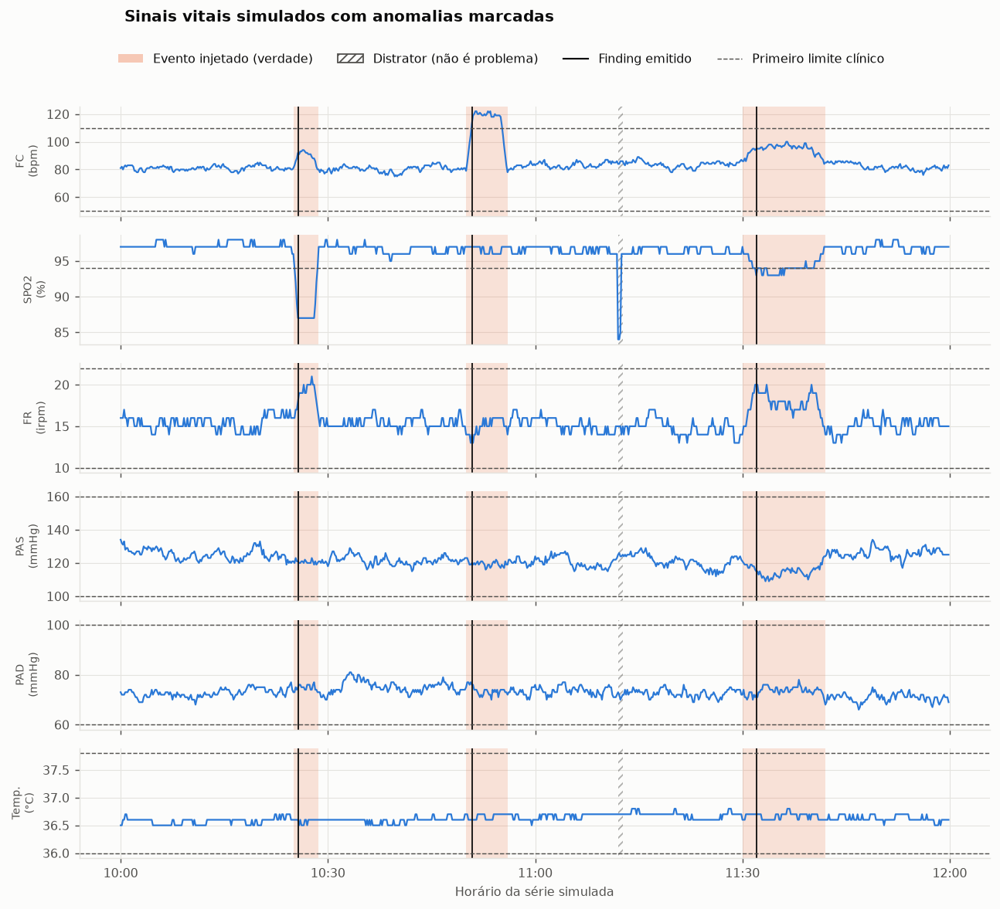
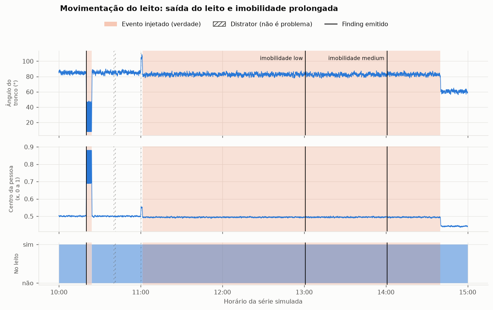
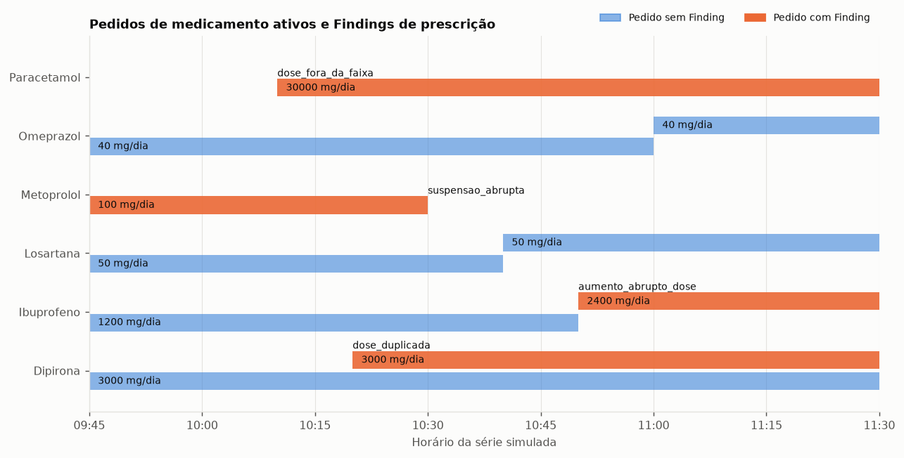

# 05. Detecção de anomalias (Integrante 3)

Este documento descreve a parte do Integrante 3: o simulador de sinais vitais, prescrições e movimentação, e os detectores de anomalia que geram os `Finding` entregues à fusão (I4).

Os dados são sintéticos e os limiares são didáticos, escolhidos só para a demonstração. Não são critério clínico validado. O sistema sinaliza risco e apoia a equipe, a decisão é sempre da equipe médica.

## 1. Visão geral

O módulo recebe três fontes de dados de cada paciente e devolve uma lista de `Finding`, no formato do contrato (`contracts/finding.py`).

| Fonte (`source`) | Entrada | Método |
|---|---|---|
| `vitals` | FC, SpO2, FR, PAS, PAD e temperatura a cada 10 s | limites clínicos, z-score robusto e Isolation Forest |
| `prescription` | pedidos e suspensões de medicamentos | regras determinísticas |
| `movement` | `movement.parquet` do vídeo do leito (I1) | regras de saída do leito e imobilidade |

Interface principal:

```python
from modules.anomaly.pipeline import analyze
findings = analyze(input, patient_id)   # list[Finding]
```

Linha de comando:

```powershell
python -m modules.anomaly.run --input outputs/video/P001/movement.parquet --patient P001 --out outputs/anomaly/P001/findings.jsonl
```

Cada detector também tem o método `update(ponto) -> list[Finding]`, para uso em fluxo (um ponto de cada vez). O `MonitorPaciente` (`monitor.py`) e o `fluxo.py` usam essa forma para reproduzir a série como se fosse em tempo real.

A saída fica na pasta do `--out`:

- `findings.jsonl`: os Findings.
- `series_flagged.parquet`: as séries com a marcação de onde houve anomalia (para o dashboard).
- `composicao_movimento.json`: só aparece quando o clipe real de movimento era curto e foi estendido com a série simulada.

## 2. Simulador

O simulador está em `modules/anomaly/simulator.py` e é configurado por `config/simulator.yaml`. A semente é fixa (2026), então a série é a mesma a cada execução.

### 2.1 Sinais vitais

Cada sinal é gerado como valor basal + oscilação lenta (deriva) + ruído AR(1):

- Amostra a cada 10 s.
- O ruído AR(1) tem `phi = 0,85`, ou seja, o ruído de agora depende do anterior. Isso deixa a série mais parecida com um monitor real do que um ruído branco.
- O basal varia de paciente para paciente, em valor absoluto de cada sinal, para o paciente continuar dentro do normal.
- Na dessaturação a FC e a FR sobem um pouco (resposta fisiológica), como acontece de fato.
- Os valores saem arredondados, como no monitor (temperatura com uma casa).

### 2.2 Anomalias injetadas

Cada injeção tem tipo, minuto de início, duração, magnitude e rampa (tempo para chegar no pico).

Anomalias que o sistema deve sinalizar:

- `dessaturacao`, `taquicardia`, `hipotensao`, `febre`, `taquipneia`
- `deterioracao_multivariada`: vários sinais mudam pouco ao mesmo tempo, sem nenhum cruzar um limite.

Distratores, que o sistema não deve sinalizar:

- `artefato_pico`: um pico de poucos segundos, típico de sensor mexido.
- `perda_sinal`: lacuna sem leitura.
- `leitura_invalida`: valor fora da faixa física do sinal.

### 2.3 Prescrições

O simulador gera o histórico de admissão (pedidos que começam 72 h antes da demonstração) e eventos como prescrever e suspender. Cada evento anômalo traz o `tipo_esperado`, que é usado como rótulo na avaliação.

### 2.4 Movimentação

O simulador gera uma série no mesmo formato do `movement.parquet` do I1 (`centroid_x`, `centroid_y`, `torso_angle`, `velocidade`, `in_bed`). O paciente fica deitado e se reposiciona de tempos em tempos, como a equipe faz na internação. Nos eventos de saída do leito, a posição vai para fora do leito com uma rampa de 20 s.

Quando existe um `movement.parquet` real, ele é usado. Se o clipe for curto (menos de 10 min), a série real é estendida com a simulada, e isso fica registrado em `composicao_movimento.json`. Se o parquet tiver `mock: true` nos metadados, o Finding leva `mock: true` na evidência.

### 2.5 Tempo

Os timestamps seguem o fuso `-03:00`. A referência da demonstração é `2026-11-03T10:00:00-03:00`. As séries `vitais` e `prescricoes` começam no deslocamento 0 e o `video_leito` no deslocamento de 600 s, conforme `data/patients.yaml`.

## 3. Detectores de sinais vitais

Código: `vitals.py`, `zscore.py`, `episodios.py`, `multivariado.py`, `monitor.py`. Configuração: bloco `vitais` e `isolation_forest` do `config/anomaly.yaml`.

### 3.1 Limites clínicos

Cada sinal tem limites para baixo e para alto, com três níveis (`medium`, `high`, `critical`). Alguns exemplos:

| Sinal | medium | high | critical |
|---|---|---|---|
| SpO2 baixa | 94 % | 90 % | 85 % |
| FC alta | 110 bpm | 130 bpm | 150 bpm |
| FC baixa | 50 bpm | 40 bpm | 30 bpm |
| PAS baixa | 100 mmHg | 90 mmHg | 80 mmHg |
| Temperatura alta | 37,8 °C | 38,5 °C | 40 °C |

A tabela completa está no `config/anomaly.yaml`. Cada sinal também tem uma faixa física: leitura fora dela é erro de sensor e é descartada (é o que trata o distrator `leitura_invalida`).

Tipos gerados: `bradicardia`, `taquicardia`, `dessaturacao`, `bradipneia`, `taquipneia`, `hipotensao`, `hipertensao`, `hipotensao_diastolica`, `hipertensao_diastolica`, `hipotermia` e `febre`.

### 3.2 Z-score robusto

O z-score comum usa média e desvio padrão, e a própria anomalia estraga esses dois valores. Por isso usei a versão robusta: compara cada leitura com a mediana da janela recente e divide pelo MAD (desvio absoluto mediano).

- Janela de 15 min (900 s), com pelo menos 60 pontos para começar a pontuar.
- `|z| >= 4,0` é desvio estatístico (severidade `low`), `5,5` vira `medium` e `7,5` vira `high`.
- Leituras anormais não entram na linha de base. Sem isso, uma anomalia longa viraria o novo normal.
- O MAD de um sinal parado (SpO2 em 97) é zero e qualquer variação daria z infinito. Por isso existe um piso na escala de cada sinal, parecido com o ruído normal do simulador.

Tipo gerado quando só o z-score dispara: `desvio_<sinal>` (por exemplo `desvio_fc`).

### 3.3 Episódios

Um desvio só vira Finding se durar um tempo mínimo, o que filtra artefato de sensor:

- 30 s quando passou de um limite clínico.
- 90 s quando é só desvio estatístico.

O `RastreadorEpisodio` controla o ciclo: o Finding é emitido uma vez quando o episódio é confirmado, é emitido de novo se a severidade piorar (escalonamento) e o episódio termina depois de 30 s normal ou de 60 s sem leitura. Todos os Findings do mesmo episódio têm o mesmo `episodio_id` na evidência, e o campo `evento` diz se foi `confirmado` ou `escalonado`.

Supressão de correlatos: quando um sinal já tem episódio clínico confirmado, os desvios só estatísticos dos outros sinais não geram Finding próprio. Exemplo: a FC sobe junto com a dessaturação, é o mesmo evento.

### 3.4 Isolation Forest

Olha os seis sinais juntos e pega combinações incomuns, mesmo quando nenhum sinal passou de limite. Foi o método de aprendizado de máquina não supervisionado visto em aula.

- Treina só com leituras que os outros detectores consideraram normais (mínimo de 120 leituras, usa as 360 mais recentes).
- 100 árvores, semente fixa.
- O limiar é o quantil 0,995 dos escores do próprio treino, vezes uma margem de 1,15, porque o escore fora do treino é um pouco pior.
- Retreina a cada 30 min. Se uma anomalia durar mais de 15 min, ela vira o novo normal.
- Precisa durar pelo menos 60 s para virar Finding.

Tipo gerado: `padrao_multivariado`, com `source = vitals`.

Limitação conhecida: em pacientes estáveis ele gera cerca de 5 % de falso alarme. Por isso ele é um complemento dos limites e do z-score, não o detector principal.

## 4. Detector de prescrições

Código: `prescription.py`. Regras determinísticas, com um catálogo de medicamentos no `config/anomaly.yaml` (dose mínima, dose máxima, dose diária máxima e se o uso é contínuo). As doses são só para a demonstração e não vêm de bula.

| Tipo | Quando dispara |
|---|---|
| `dose_fora_da_faixa` | dose ou dose diária fora do catálogo do medicamento |
| `dose_duplicada` | pedido repetido do mesmo medicamento enquanto o anterior segue ativo |
| `aumento_abrupto_dose` | aumento da dose diária em relação ao pedido anterior (medium a partir de 50 %, high a partir de 100 %, critical a partir de 300 %), comparando só com pedido encerrado nas últimas 72 h |
| `suspensao_abrupta` | medicamento contínuo, em uso há pelo menos 24 h, suspenso sem novo pedido em 30 min (tempo curto de propósito, para a demonstração) |

A suspensão abrupta depende de um relógio: o `avancar_relogio` avança o tempo mesmo sem evento novo, para o detector perceber que os 30 min passaram.

## 5. Detector de movimentação

Código: `movement.py`. Usa o `movement.parquet` do I1 (cerca de 5 Hz). Quando a pessoa não é detectada, a pose vem como NaN, e o `in_bed` segura o valor por 1 s antes de virar falso.

Saída do leito (`saida_do_leito`):

- Confirma depois de 3 s seguidos fora do leito.
- Encerra depois de 10 s de volta.
- A pessoa precisa ter ficado pelo menos 5 s no leito antes, senão não conta como saída.
- Severidade `medium` (score 0,70). Vira `high` (0,85) se a ausência passar de 10 min.

Imobilidade prolongada (`imobilidade_prolongada`):

- A pose é resumida em blocos de 1 min (mediana).
- Pose igual significa ângulo do tronco dentro de 10 graus e centro dentro de 0,04 da pose de referência.
- 2 h na mesma pose é `low`, 3 h (1,5 vezes) é `medium` e 4 h (2 vezes) é `high`.
- O contador zera quando a pessoa se reposiciona, sai do leito ou fica mais de 5 min sem pose.

## 6. Formato dos Findings

Todos os detectores usam o mesmo contrato. Exemplo de um Finding de vitais:

```json
{
  "patient_id": "P001",
  "source": "vitals",
  "type": "dessaturacao",
  "timestamp_start": "2026-11-03T10:45:20-03:00",
  "timestamp_end": "2026-11-03T10:45:50-03:00",
  "score": 0.87,
  "severity": "high",
  "description": "Saturação de oxigênio: pior valor 87 %, além do limite de 90 % (episódio de 30 s).",
  "evidence": {"sinal": "spo2", "valor": 87.0, "limite_cruzado": 90.0, "episodio_id": "spo2-1", "evento": "confirmado", "duracao_s": 30.0},
  "model": {"name": "vitais-limites-zscore", "version": "1.0"}
}
```

Nomes de modelo usados: `vitais-limites-zscore`, `isolation-forest`, `prescricoes-regras` e `movimento-regras` (todos na versão 1.0).

O módulo só emite Findings. Quem decide o que vira alerta é a fusão (I4).

## 7. Resultados da avaliação

Comando: `python -m modules.anomaly.avaliacao`. São 505 pacientes simulados, com sementes diferentes das usadas para calibrar os limiares (7001 na avaliação).

Como a comparação é feita:

- Cada Finding é comparado com os rótulos dos eventos injetados. Nos vitais conta a sobreposição no tempo (com tolerância, qualquer tipo). Em movimentação e prescrição o tipo precisa ser o mesmo.
- Precisão é calculada por Finding e recall por evento.
- O atraso desconta o tempo de espera que a própria regra tem (2 h na imobilidade e 30 min na suspensão).
- Os intervalos de confiança de 95 % são de Wilson.

| Módulo | Eventos achados | Recall (IC 95 %) | Precisão (IC 95 %) | F1 | Atraso mediano (p90) |
|---|---|---|---|---|---|
| Vitais: limites + z-score | 72/80 | 90,0 % (81 a 95) | 98,2 % (94 a 99) | 93,9 % | 60 s (2,3 min) |
| Vitais: só Isolation Forest | 7/80 | 8,8 % (4 a 17) | 100 % (70 a 100), com 9 Findings | 16,1 % | 4,3 min (9,6 min) |
| Vitais: tudo junto | 73/80 | 91,2 % (83 a 96) | 98,3 % (94 a 100) | 94,7 % | 60 s (2,3 min) |
| Prescrições (regras) | 153/153 | 100 % (98 a 100) | 100 % (98 a 100) | 100 % | 0 s |
| Movimentação (regras) | 92/92 | 100 % (96 a 100) | 100 % (96 a 100) | 100 % | 3 s (4 s) |

Por tipo de evento nos vitais (tudo junto): dessaturação 14/14, febre 10/10, hipotensão 14/14, taquicardia 20/20, taquipneia 6/6 e deterioração multivariada 9/16.







Exemplos de séries com as anomalias marcadas:







### Como ler esses números

- Os dados são sintéticos e o mesmo projeto gera os eventos e mede a detecção. Por isso prescrição e movimentação dão 100 %: as regras fazem o que foram escritas para fazer. Isso não prova que funcionariam num hospital real.
- O ponto fraco é a deterioração multivariada: todos os 7 eventos perdidos nos vitais são desse tipo. Com intensidade 0,3 vezes o padrão o sistema não acha nada, com 0,6 acha cerca de 30 % e a partir de 1,0 acha tudo.
- O Isolation Forest só detecta a deterioração multivariada e mesmo assim com recall baixo (7 dos 16 eventos, ou 43,8 %). Ele entra como complemento.
- Na avaliação os eventos de um mesmo paciente não se sobrepõem (existe uma folga entre eles). Em dados reais isso seria bem mais bagunçado.

## 8. Limitações

- Limiares didáticos, sem validação clínica.
- Dados sintéticos, sem ruído de uso real (eletrodo solto, paciente falando, medicação, etc.).
- O catálogo de medicamentos tem 7 itens e as doses não vêm de bula.
- A suspensão abrupta usa 30 min só para a demonstração. Num uso real esse tempo seria bem maior.
- O Isolation Forest tem cerca de 5 % de falso alarme em paciente estável.
- A movimentação depende da qualidade da pose do I1. Se a pessoa não é detectada por mais de 3 s, hoje conta como saída do leito.

## 9. Integração com os outros módulos

### 9.1 Fonte dos dados

Os sinais vitais e as prescrições são sintéticos, gerados pelo simulador da seção 2 com o catálogo didático de medicamentos do `config/anomaly.yaml`. Não usei MIMIC-IV Demo nem BIDMC (PhysioNet). A movimentação usa o `movement.parquet` real do Integrante 1 (Charades SSP8C) quando ele existe, estendido com a série simulada.

### 9.2 O que o módulo recebe do vídeo

O `movement.parquet` do Integrante 1 segue as unidades descritas na seção 7.8 do README, e o detector foi escrito para elas: `centroid_x` e `centroid_y` entre 0 e 1, `torso_angle` em graus, `velocidade` em unidades normalizadas por segundo, e `in_bed` booleano. Quando a pessoa não é detectada, a pose vem como NaN e o `in_bed` mantém o último estado por até 1 s. Hoje, depois disso, o detector conta como fora do leito.

### 9.3 O que o módulo entrega

| Artefato | Onde |
|---|---|
| Findings (`vitals`, `prescription`, `movement`) | `outputs/anomaly/<paciente>/findings.jsonl` |
| Séries com anomalias marcadas, para o dashboard | `outputs/anomaly/<paciente>/series_flagged.parquet` |
| Findings em fluxo | `update()` dos detectores, reproduzido pelo `fluxo.py` |

O `series_flagged.parquet` é longo, com as colunas `patient_id`, `timestamp`, `source`, `signal`, `value`, `flagged`, `finding_id` e `severity`.

### 9.4 Cenário do P001

O cenário `p001_integrado` do `config/simulator.yaml` casa com a linha do tempo do P001 no README:

| Horário | Origem | Finding |
|---|---|---|
| 10:10 | `movement` | `saida_do_leito` (medium) |
| 10:20 | `prescription` | `dose_duplicada` (high) |
| 10:45 | `vitals` | `dessaturacao` (high) |

A dessaturação fica às 10:45 para cair na mesma janela de 30 min da regra crítica da fusão (indicador vocal às 10:30, nota às 10:40).

### 9.5 Severidade e alertas

A fusão transforma Finding isolado em alerta pela severidade: `low` e `medium` viram atenção, `high` vira urgente e `critical` vira crítico. Um Finding `critical` sozinho já vira alerta crítico, então os detectores só usam esse nível nos limites mais extremos (por exemplo SpO2 abaixo de 85 %).
